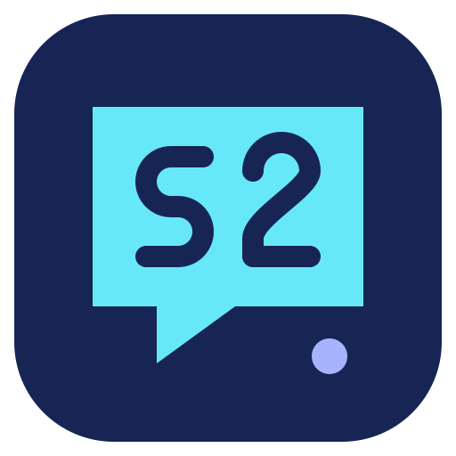

# Slippy2 Desktop

**An independent fork maintained by Maskarauder. Not affiliated with, supported
by, or endorsed by Zaytri or the upstream Slime2 project.**

This project is derived from [Zaytri's Slime2 Desktop](https://github.com/zaytri/slime2-desktop)
and includes contributions developed with generative-AI assistance.

The [upstream README](https://github.com/zaytri/slime2-desktop#readme) states that
its contents are not to be used in machine-learning models and that forks and
pull requests containing generative-AI-assisted contributions will not be
accepted. In response, **Maskarauder chose to detach this repository** from
GitHub's upstream fork network. This was the fork maintainer's decision in
response to the published policy, not a direct request from the upstream author.
Detachment does not change the project's origin or claim upstream endorsement.

[Fork releases](https://github.com/maskarauder/slime2-desktop/releases) ·
[Fork issues and support](https://github.com/maskarauder/slime2-desktop/issues) ·
[Independence notice and original credits](NOTICE.md)

The original [LICENSE](LICENSE) and [AGPLv3-or-later license text](COPYING) are
retained. Please direct support requests for this fork to this repository.

## Upgrading from this fork

Slippy2 Desktop is the new name for Maskarauder's detached Slime2 Desktop fork.
Existing installations keep their settings, widgets, and stored accounts. The
repository and update URLs retain their current location during this branding
change. See [upgrade compatibility](docs/DEVELOPMENT.md#branding-and-upgrade-compatibility)
for the retained internal identifiers and installer checks.

## Setup

This fork is a desktop app for Linux, Windows, and macOS built using Tauri, Vite, React, and TypeScript.

Here is what you need to run the app in development mode:

1. Install the Tauri prerequisites: https://tauri.app/start/prerequisites/
    - Just need the system dependencies, Rust, and Node.js; this is not built for mobile so skip the mobile configuration.
    - For Linux, will also need to install GStreamer.
        - Fedora/Ubuntu/Debian instructions: https://gstreamer.freedesktop.org/documentation/installing/on-linux.html?gi-language=c
        - Arch Linux instructions: https://wiki.archlinux.org/title/GStreamer (install all of the common package set)
2. Use Node.js 22 and run `npm run setup` from the repository root to install
   the committed desktop and overlay dependencies.
3. Run `npm run verify` for the offline regression tests, frontend checks/builds,
   and Rust transport tests. Use `npm run verify -- --desktop` to also compile
   and test the full native app with your platform's Tauri prerequisites.
4. Run `npm start` for development. Make sure another copy of the app is not running.

See [docs/DEVELOPMENT.md](docs/DEVELOPMENT.md) for the architecture, project paths,
Windows installer checks, test fixtures, logging and `npm run version:set`.
Cargo downloads locked dependencies during builds; `cargo update` is not needed
for setup.

> When updating built-in widgets in `/resources/widgets`, you will need to close the app and run `npm start` again, since it only sets the `resources` folder upon initialization. Installed widgets can be upgraded from a ZIP through **Update widget** while preserving compatible settings; see [widget updates](docs/WIDGET-UPDATES.md).

> If you're using VS Code, it will auto suggest useful extends from [extensions.json](.vscode/extensions.json) and [settings.json](.vscode/settings.json) in the `.vscode` folder.

## YouTube live chat setup

YouTube chat uses Google's installed-app OAuth flow and needs a Google Cloud
Desktop app client ID and client secret for your fork:

1. Create or select a Google Cloud project and enable the
   [YouTube Data API v3](https://console.cloud.google.com/apis/library/youtube.googleapis.com).
2. Configure the OAuth consent screen. If the app is in testing mode, add the
   Google account that owns the YouTube channel as a test user.
3. On the [Google Auth clients](https://console.cloud.google.com/auth/clients)
   page, create an OAuth client with application type **Desktop app**.
4. In Slippy2 Desktop, add a **Read Account**, choose YouTube, paste the client ID and
   client secret, and finish authorization in the system browser. The secret is
   stored with the account tokens in the operating system credential store.
5. Install or update the Slime2 Chat Box to version 1.6.0 or newer, then select
   the YouTube read account in its YouTube account slot (or make that account
   the default).

The current integration reads the authenticated channel's active live chat. It
does not send YouTube chat messages.

## Live-chat recovery

YouTube live chat uses Google's `liveChatMessages.streamList` gRPC connection
in the Rust backend. One reader per account shares messages with all widgets;
adding browser sources does not add Google API readers. The connection stays
open during quiet chat, with HTTP/2 keepalive to detect a broken network.
Connecting has a 30-second deadline per connection/RPC-opening stage; the
established stream has no message-inactivity deadline. Reconnects use the last
successfully delivered `nextPageToken` and suppress duplicate message IDs.

After three consecutive streaming failures (or an unsupported streaming
endpoint), Slippy2 Desktop uses the existing REST `liveChatMessages.list` API for ten
minutes before trying streaming again. REST polls wait **at least 30 seconds**
between requests, including retries, and honor a longer `pollingIntervalMillis`
when Google requests it. Each REST response can contain up to 2,000 messages.
Only one transport reads chat at a time. If the stream ends, Slippy2 Desktop checks for
another active broadcast once per minute.

`streamList` is still part of the YouTube Data API v3; it reduces polling but
does not bypass Google quotas. Account/channel lookup and broadcast discovery
also still use the REST API. Quota failures pause the reader for 15 minutes
before retrying, keeping the saved authorization. Repeated permission or gRPC
resource-limit failures also pause instead of repeatedly switching transports.

Saved YouTube credentials are kept
when a refresh attempt times out or Google returns a temporary server, rate
limit, or network error. The account is marked for reconnection only when
Google rejects the credentials themselves, such as `invalid_grant` or
`invalid_client`.

TikTok LIVE connections have a 30-second connection deadline. After 30 seconds
without a WebSocket frame, Slippy2 Desktop sends a protocol ping and waits 15 seconds
for a response. A dead connection is closed and retried; normal quiet chat is
left connected. Euler Stream's offline and no-message close codes are logged
as reconnectable status events.

The recovery code logs the account name, retry delay, safe HTTP status/reason,
and recovery event. It never logs OAuth headers, access tokens, refresh tokens,
or API keys. Rebuild Slippy2 Desktop after applying the patch; existing account and
widget settings do not need to be recreated.

### YouTube streaming development

The transport and message conversion live in `src-tauri/youtube-stream/`,
using Google's schema in `src-tauri/youtube-stream/proto/stream_list.proto`.
The build downloads a bundled Protocol Buffers compiler through Cargo;
Windows builds do not require a separate `protoc` installation. Build Slippy2 Desktop
normally with `npm ci` and `npm run build` after applying this patch.

The Tauri commands are in `src-tauri/src/youtube.rs`. Frontend lifecycle,
fallback timing and widget delivery are connected through
`src/helpers/services/youtube/youtubeStream.ts`,
`src/helpers/services/youtube/youtubeChatReader.ts` and
`src/hooks/useYouTubeChat.ts`. Existing widgets consume the same event format.

Run the focused checks from the repository root:

```sh
node --test tests/youtube-streamlist.test.mjs tests/youtube-error-details.test.mjs
cargo test --manifest-path src-tauri/youtube-stream/Cargo.toml
cargo check --manifest-path src-tauri/Cargo.toml
```

The transport tests use a local gRPC server and do not require Google
credentials or quota. A live test should show `YouTube streamList connected`
in Slippy2 Desktop's log. A blocked gRPC connection instead logs the REST fallback and
its 30-second minimum interval. Test a quiet period and a network interruption
as well as normal messages before relying on the new build during a stream.

References: [Google's streaming guide](https://developers.google.com/youtube/v3/live/streaming-live-chat)
and [`streamList` reference](https://developers.google.com/youtube/v3/live/docs/liveChatMessages/streamList).

## Experimental TikTok LIVE chat setup

TikTok does not provide an official public API for reading LIVE chat. This fork
therefore connects through the third-party
[Euler Stream](https://www.eulerstream.com/) WebSocket gateway. The integration
is read-only and does not ask for a TikTok password or session cookie, but it may
need updates when TikTok changes its internal LIVE service.

1. Create an Euler Stream account and API key. Service limits and pricing are
   controlled by Euler Stream.
2. In Slippy2 Desktop, add a **Read Account**, choose **TikTok LIVE (Experimental)**,
   and enter the broadcaster's public username plus your Euler Stream API key.
3. Install or update the Slime2 Chat Box to version 1.7.0 or newer, then select
   the TikTok read account in its TikTok account slot (or make it the default).

Slippy2 Desktop stores the Euler Stream key in the operating system credential store,
connects from the Tauri backend, and automatically retries while the broadcaster
is offline. TikTok chat sending and 7TV/BTTV/FFZ emotes are not supported for
TikTok; native TikTok chat emotes are rendered when the gateway includes them.
